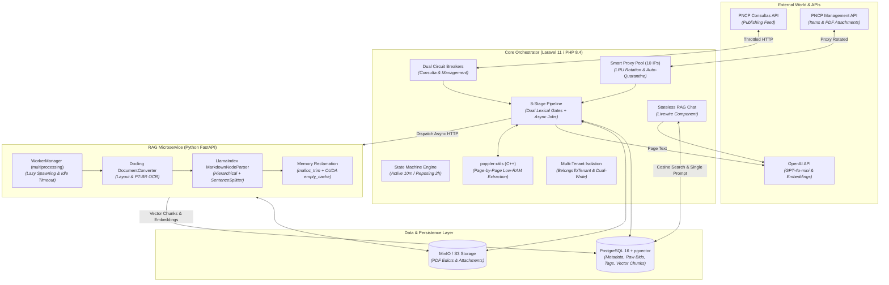
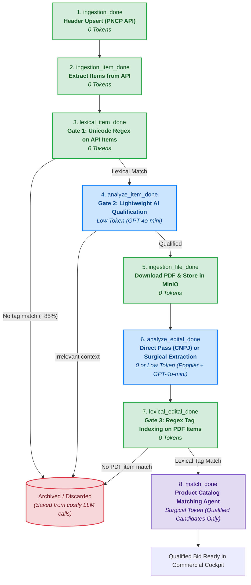
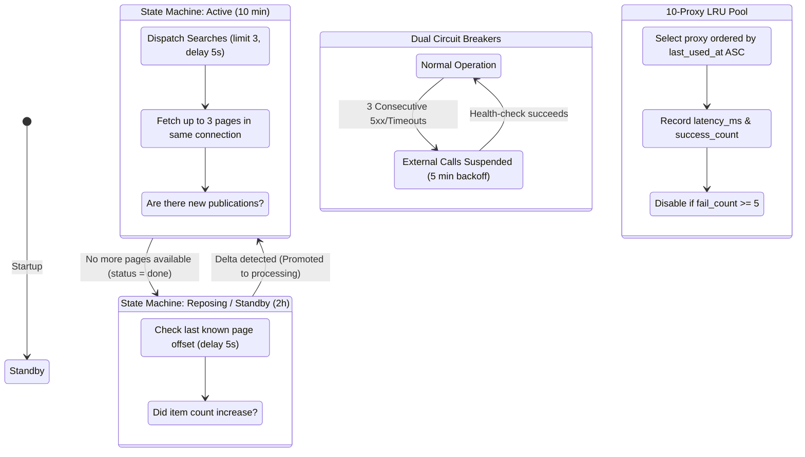
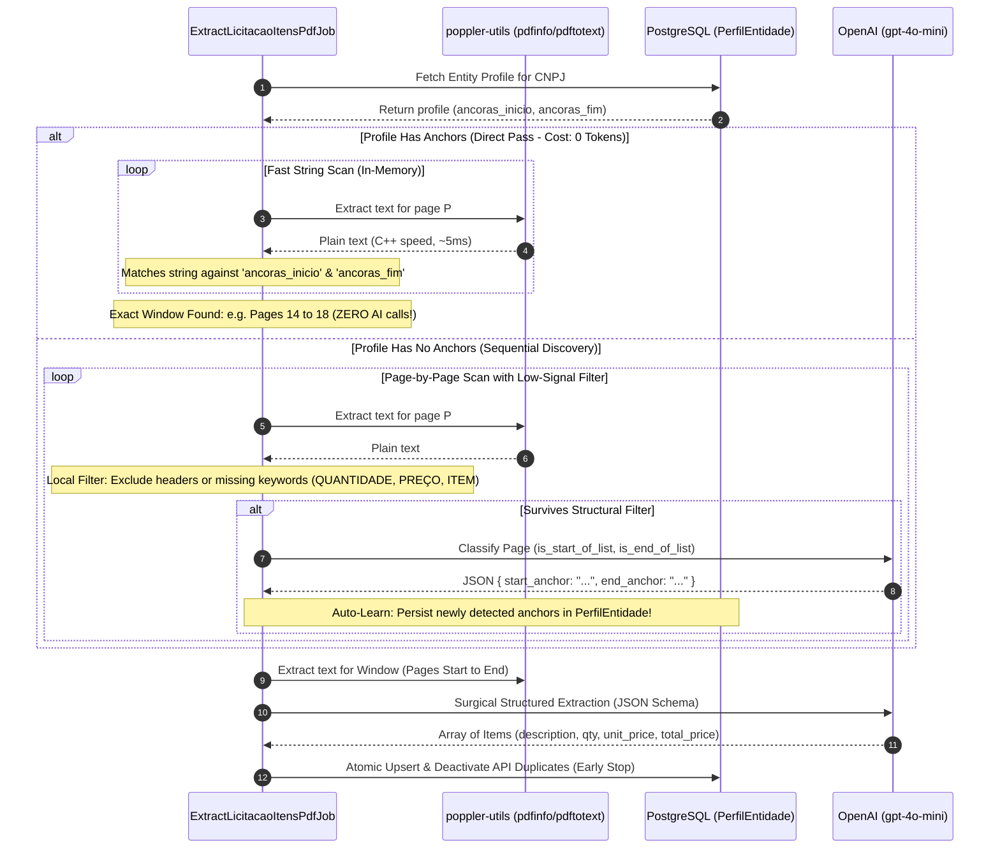
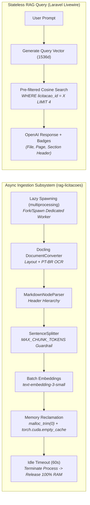

# GovTech AI Pipeline: 8-Stage Progressive Funnel, Self-Learning PDF Parsing & Resilient Government API Ingestion

[](https://github.com/marcos-reis/govtech-ai-pipeline)
[](https://github.com/marcos-reis/govtech-ai-pipeline)
[-violet?style=flat-square)](https://github.com/marcos-reis/govtech-ai-pipeline)

> **Case Study & Architectural Showcase:** An enterprise B2B platform processing thousands of daily public tender opportunities across all 27 Brazilian states from the National Public Procurement Portal (PNCP). Solves government API instability, IP bans, memory constraints on lean cloud instances, and token cost explosion via progressive filtering, self-learning entity templates, and ephemeral PyTorch workers.

---

## 📑 Table of Contents

1. [Executive Summary & The Business Problem](#1-executive-summary--the-business-problem)
2. [Architectural Overview & Core Components](#2-architectural-overview--core-components)
3. [The 8-Stage Progressive Cost Funnel](#3-the-8-stage-progressive-cost-funnel)
4. [Government API Resilience, Proxy Rotation & Adaptive Ingestion](#4-government-api-resilience-proxy-rotation--adaptive-ingestion)
5. [Self-Learning PDF Table Extraction (*Direct Pass* via CNPJ Anchors)](#5-self-learning-pdf-table-extraction-direct-pass-via-cnpj-anchors)
6. [Ephemeral Python RAG Subsystem & Memory Reclamation Lifecycle](#6-ephemeral-python-rag-subsystem--memory-reclamation-lifecycle)
7. [Engineering Metrics & FinOps Impact](#7-engineering-metrics--finops-impact)
8. [Architectural Decision Records (ADRs)](#8-architectural-decision-records-adrs)

---

## 1. Executive Summary & The Business Problem

In public procurement (GovTech in Brazil), thousands of public tenders (*licitações*) are published daily on the official federal portal (PNCP). For distributors and manufacturers, identifying relevant bids, analyzing requirements, and matching them against private product catalogs is a mission-critical yet operationally expensive workflow.

```
                           THE FINOPS & SCALE DILEMMA
                           
  Naive Approach (Send all to LLM):
  [Thousands of Bids/Day] ──▶ [Download All PDFs (100+ pages)] ──▶ [LLM Context Window]
  ❌ Cost: Thousands of USD/day in tokens
  ❌ Latency: Bottlenecks & rate-limit crashes
  ❌ WAF Bans: Government API IP blocking under naive scraping
  
  Our Solution (8-Stage Progressive Funnel):
  [Thousands of Bids] ──▶ [Dual Lexical Gates] ──▶ [Self-Learning PDF Parser] ──▶ [LLM Match]
  ✅ Cost: Zero-token filtering on ~85% of volume
  ✅ Resilience: Dual Circuit Breakers + 10-Proxy Pool Rotation + Active/Reposing State Machine
  ✅ Lean Infra: Single EC2 instance running Docling OCR + PyTorch with zero memory leaks
```

### Key Bottlenecks Solved
1. **The Token Cost Crisis (FinOps):** Naively sending raw tenders or downloading entire 100+ page edict PDFs to LLMs explodes operating costs.
2. **Ambiguous API Metadata:** Government APIs often provide generic header descriptions (e.g., *"Acquisition of diverse materials"*), burying the actual items (e.g., *"100W LED Luminaire"*) inside nested tables or attached PDFs.
3. **Severe Government API Instability & IP Banning:** The public endpoints frequently fail with 5xx errors, rate limits (429), or strict Cloudflare WAF IP blocks.
4. **Memory Leaks in Python/PyTorch OCR Workers:** Running deep learning OCR and document parsing models (`Docling`, PyTorch) alongside a web server on a cost-effective virtual machine (AWS EC2) tends to exhaust RAM/VRAM over time due to C-level fragmentation.

---

## 2. Architectural Overview & Core Components

The system was architected as a hybrid, event-driven monolith and microservices model orchestrated via **Docker Compose**:



---

## 3. The 8-Stage Progressive Cost Funnel

Every incoming public tender transitions through an explicit state machine, enforcing isolation between tenants and eliminating unpromising records using zero-token computation before any LLM is called.



### Detailed Stage Breakdown

| Stage | Trigger / Command | Technology / Mechanism | Token Cost | Retained Volume |
| :--- | :--- | :--- | :--- | :--- |
| **1. `ingestion_done`** | `pncp:dispatch-active-searches` | Throttled HTTP Polling + SQL Upsert | **0 tokens** | 100% |
| **2. `ingestion_item_done`** | `pncp:ingest-items` | Paged Management API Calls (Page size 50) | **0 tokens** | 100% |
| **3. `lexical_item_done`** | `pncp:analyze-lexical` | Unicode-safe Regex matching against Tenant Tag Dictionary | **0 tokens** | **~15%** |
| **4. `analyze_item_done`** | `pncp:analyze-ai` | `gpt-4o-mini` qualifying high-level scope & intent | Low (~300 tokens) | **~8%** |
| **5. `ingestion_file_done`** | `pncp:ingest-files` | Stream download, Magic Number (`%PDF`) validation, MinIO/S3 | **0 tokens** | ~8% |
| **6. `analyze_edital_done`** | `pncp:extract-items-ai` | `poppler-utils` (C++) + CNPJ Direct Pass or Sequential Discovery | **0 tokens (Direct Pass)** or Low | ~6% |
| **7. `lexical_edital_done`** | `pncp:analyze-lexical-edital` | Re-index PDF items, link tags & atomically deactivate API duplicates | **0 tokens** | ~4% |
| **8. `match_done`** | `pncp:analyze-match` | Tag intersection ranking + `gpt-4o-mini` SKU verification | Optimized (~800 tokens) | **~2%** |

---

## 4. Government API Resilience, Proxy Rotation & Adaptive Ingestion

Operating against the PNCP API revealed critical real-world failure modes:
1. **Asymmetric Outages:** The Search/Consultas API and the Management API fail independently.
2. **Aggressive WAF Rate-Limiting & IP Bans:** Frequent scraping triggers IP bans.
3. **Limited Proxy Resources:** The system operated under a constrained pool of **10 reverse proxy IPs**.



### Key Architectural Safeguards
* **Dual Circuit Breakers:** `PncpConsultaCircuitBreaker` and `PncpManagementCircuitBreaker` protect both ends. Middleware trips the circuit on consecutive network errors, suspending queue workers for 5 minutes instead of burning retries.
* **Smart Proxy Pool (`Proxy` Model):**
  * **Least-Recently-Used (LRU) Selection:** Requests always pick the active proxy with the oldest `last_used_at`.
  * **Automated Quarantine:** Automatically disables a proxy when `fail_count >= 5`, keeping latency telemetries for health diagnostics.
* **Connection Re-use & Multi-Page Ingestion:** Rather than opening separate HTTP handshakes, each job ingests up to 3-5 consecutive pages (50 items each) per connection cycle, updating `ExtractionTracker` with exact offsets (`realtime_last_count`).

---

## 5. Self-Learning PDF Table Extraction (*Direct Pass* via CNPJ Anchors)

Edicts often exceed 50 to 150 pages, but the table of items typically occupies only 3 to 10 pages. Sending all pages to an LLM is financially prohibitive.



### Highlights of the PDF Extraction Engine:
1. **Low-RAM C++ Page Parsing:** `poppler-utils` (`pdftotext -f P -l P`) extracts text page-by-page directly into memory, preventing Node/PHP/Python memory ballooning.
2. **Direct Pass (Zero-Token Discovery):** After an entity's anchors are learned once, subsequent tenders from the same city hall or agency bypass LLM page discovery entirely.
3. **Early Stop:** Once the items table is extracted, remaining tender attachments are skipped.

---

## 6. Ephemeral Python RAG Subsystem & Memory Reclamation Lifecycle

When users ask questions regarding specific tender rules (e.g., qualification criteria, submission deadlines, warranty terms), the system uses a specialized **RAG microservice (`rag-licitacoes`)**.



### Memory Management in Python Worker (`worker.py`)
Document processing libraries (PyTorch, Docling, CUDA) suffer from high memory fragmentation. The system implements a **Lazy-Spawned Process Worker with Idle Timeout**:
* The worker process spawns only when a job is enqueued.
* After processing each file, it explicitly calls `gc.collect()`, `torch.cuda.empty_cache()`, and invokes `libc.so.6 -> malloc_trim(0)` to force the Linux kernel to reclaim unmapped heap memory.
* If idle for >60 seconds, the worker process terminates completely, returning 100% of RAM/VRAM to the host OS.

---

## 7. Engineering Metrics & FinOps Impact

| Metric / Dimension | Naive Architecture | GovTech Pipeline Architecture | Measured Improvement |
| :--- | :--- | :--- | :--- |
| **Token Cost per Processed Tender** | ~$0.15 - $0.45 / tender | ~$0.003 / tender | **~98% reduction in token costs** |
| **Unpromising Volume Discard Rate** | 0% (All sent to LLMs) | ~85% in Stage 3 (Lexical Gate) | **Immediate deselect at 0 token cost** |
| **PDF Discovery Cost on Recurring Agencies** | ~15 LLM calls / edict | **0 LLM calls (Direct Pass)** | **100% cost reduction on page discovery** |
| **Server RAM Footprint on Heavy OCR Runs** | > 3.8 GB (Memory Leak / Crash) | < 800 MB baseline (Worker Idle) | **Stable 24/7 operation on modest EC2** |
| **API Availability & Scraping Uptime** | Frequent 429/403 IP Bans | Continuous 24/7 national polling | **Zero downtime with Circuit Breakers & Proxy LRU** |

---

## 8. Architectural Decision Records (ADRs)

Detailed rationale, options considered, and trade-offs are documented in the [`adr/`](./adr/) directory:

- [**ADR-001:** Progressive Cost Funnel and Dual Lexical Gates](./adr/ADR-001-progressive-funnel-and-dual-lexical-gates.md)
- [**ADR-002:** Self-Learning PDF Anchors by Entity CNPJ (*Direct Pass*)](./adr/ADR-002-self-learning-pdf-anchors-by-cnpj.md)
- [**ADR-003:** Government API Resilience, Dual Circuit Breakers, and Proxy Throttling](./adr/ADR-003-government-api-resilience-and-proxy-throttling.md)
- [**ADR-004:** Ephemeral Python Worker Lifecycle and OS Memory Reclamation](./adr/ADR-004-ephemeral-python-worker-and-memory-reclamation.md)
- [**ADR-005:** Stateless Pre-Filtered RAG with Hierarchical Markdown Chunking](./adr/ADR-005-stateless-rag-and-hierarchical-markdown-chunking.md)

---

## 9. Code Snippets & Technical Artifacts

Sanitized implementation references are available in the [`snippets/`](./snippets/) directory:
- [`EphemeralWorkerMemoryCleanup.py`](./snippets/EphemeralWorkerMemoryCleanup.py): Multi-processing worker manager and `malloc_trim` cleanup implementation.
- [`SelfLearningPdfExtractor.php`](./snippets/SelfLearningPdfExtractor.php): CNPJ anchor learning, Poppler text extraction, and atomic deduplication.
- [`SmartProxyRotationAndCircuitBreaker.php`](./snippets/SmartProxyRotationAndCircuitBreaker.php): LRU proxy pool rotation, quarantine logic, and dual circuit breakers.

---

*Case Study developed and maintained by **[Marcos Reis](https://github.com/marcos-reis)** — Senior Software Engineer & GenAI Architect.*
