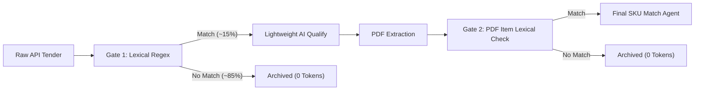

# ADR-001: Progressive Cost Funnel and Dual Lexical Gates

## Status
Accepted (In Production)

## Context
In the Brazilian public procurement sector (PNCP), thousands of public tenders (*licitações*) are published daily across federal, state, and municipal entities. Each tender contains varying levels of metadata in the API response: some provide detailed item lists, while others only provide generic descriptions (e.g., *"Acquisition of operational and electrical consumables"*).

In early testing, sending tender descriptions and items directly to Large Language Models (LLMs) like GPT-4 for qualification and catalog matching resulted in:
1. **Severe Token Cost Inefficiency (FinOps Failure):** Over 85% of published tenders belong to completely unrelated domains (e.g., pharmaceuticals, school meals, construction labor). Processing all raw records through LLMs would cost thousands of dollars per month.
2. **Double AI Ingestion Waste:** Processing items from the API with an LLM and then later analyzing attached edict PDFs with another LLM created redundant token expenditures for items that were already out of scope.

## Decision
We implemented an **8-Stage Progressive Cost Funnel** featuring **Dual Lexical Gates** using Unicode-safe regular expressions and tenant-specific tag dictionaries:

1. **Gate 1 (Post-API Ingestion / Stage 3 - `lexical_item_done`):**
   - Before invoking any AI models, raw strings from tender headers and item descriptions are evaluated locally against the tenant's tag dictionary.
   - Any tender that does not match at least one relevant keyword or synonym is immediately archived (`archived`), eliminating ~85% of irrelevant volume at **0 token cost**.
2. **Lightweight AI Qualification (Stage 4 - `analyze_item_done`):**
   - Only records passing Gate 1 are sent to `gpt-4o-mini` for fast contextual validation (separating product purchase from pure manpower/service contracts).
3. **Gate 2 (Post-PDF Extraction / Stage 7 - `lexical_edital_done`):**
   - Items extracted from attached PDFs (which often differ from or expand upon the high-level API items) must pass a second lexical regex check before reaching the matching agent.
   - API-generated duplicate items are atomically marked as `IGNORADO_DUPLICADO`.
4. **Targeted SKU Match Agent (Stage 8 - `match_done`):**
   - The LLM matching agent is only invoked on high-confidence, pre-filtered item candidates, comparing technical specifications against the private product catalog.

## Consequences

### Positive
- **Drastic Cost Reduction:** Reduced total token expenditure by ~98% compared to naive end-to-end LLM processing.
- **Sub-Millisecond Gate Latency:** Local regex evaluations execute in microseconds without network I/O.
- **High Precision:** Eliminates false positives before triggering downstream PDF download and OCR pipelines.

### Negative / Trade-offs
- **Dictionary Maintenance:** Requires tenants to configure and maintain synonym tags for their product lines (mitigated via an intuitive CRUD tag manager in the backoffice).
- **Potential False Negatives:** If a tender uses obscure non-standard terminology not captured in synonyms, it may be filtered out at Gate 1 (mitigated by periodically reviewing high-volume untagged tenders).
