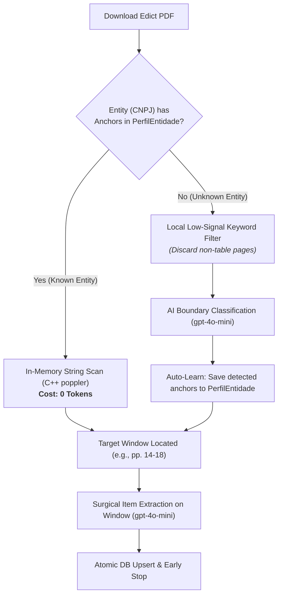

# ADR-002: Self-Learning PDF Anchors by Entity CNPJ (*Direct Pass*)

## Status
Accepted (In Production)

## Context
When public tenders pass preliminary qualification, detailed technical specifications (voltage, wattage, dimensional limits, delivery milestones, Inmetro certifications) must be extracted from attached PDF edicts (*editais* and *termos de referência*).

These PDFs frequently span **50 to 150+ pages**, yet the actual table of items and technical requirements typically occupies only **3 to 10 pages** located somewhere in the middle or end of the document.

Sending the entire PDF text to an LLM or running brute-force page-by-page LLM classification across every document introduces major drawbacks:
1. **High Token Costs:** Classifying 50+ pages with an LLM for each qualified tender costs significant tokens.
2. **Context Window / Truncation Limits:** Truncating text to early pages (e.g., first 8,000 characters) frequently misses item tables placed in annexes.
3. **Repeated Structure from the Same Public Agencies:** Municipalities, state secretariats, and public utilities follow standardized procurement templates. For example, a city hall's tenders often introduce the item table with the exact phrase *"ANEXO I - TERMO DE REFERÊNCIA"* and conclude with *"CLÁUSULA DE SANÇÕES"*.

## Decision
We implemented a **Self-Learning Entity Profile Engine (`PerfilEntidade`)** combined with **Low-RAM C++ Page Parsing (`poppler-utils`)**:

1. **Lightweight Page-by-Page Reading:**
   - Instead of loading massive PDF objects in memory or converting all pages to images, the system uses Linux's `poppler-utils` (`pdftotext -f P -l P`) to read text page-by-page directly into memory in milliseconds.
2. **Direct Pass (Zero-Token Discovery for Known Entities):**
   - For any public agency (identified by clean `cnpj`), the system queries `PerfilEntidade` for learned `ancoras_inicio` (start anchors) and `ancoras_fim` (end anchors).
   - If anchors exist, the worker executes fast in-memory string matching (`str_contains`). Once the start and end pages are located, the extraction window is identified immediately with **zero LLM calls**.
3. **Sequential AI Discovery with Auto-Learning (For Unknown Entities):**
   - If anchors do not exist or fail to match, the system runs sequential page discovery.
   - **Local Low-Signal Filter:** Pages are evaluated locally for structural tabular keywords (`QUANTIDADE`, `PREÇO`, `VALOR`, `ITEM`, `DESCRIÇÃO`) or exclusion terms. Pages without structural keywords are skipped locally.
   - **LLM Boundary Classification:** Surviving candidate pages are sent to `gpt-4o-mini` with a structured schema to identify `is_start_of_list`, `is_end_of_list`, and the exact textual header (`detected_start_anchor` / `detected_end_anchor`).
   - **Auto-Persistence:** When boundaries are detected, new anchor strings are automatically appended to the entity's profile (`PerfilEntidade`) for that CNPJ.
4. **Surgical Deep Extraction:**
   - Only the identified page window (e.g., Pages 14 to 18) is concatenated and sent for structured item extraction (`extractItens`), followed by atomic database insertion and **Early Stop**.

## Consequences

### Positive
- **Zero Token Cost for Discovery on Recurring Agencies:** Once a public body's template is learned, all future tenders from that agency locate item tables in 0 tokens.
- **Resilient to Edict Length:** Easily handles 100+ page edicts without truncating tables in annexes.
- **Low Memory Footprint:** Page-by-page extraction via `poppler-utils` uses negligible RAM compared to rendering full-document PDF canvases.

### Negative / Trade-offs
- **Template Revisions:** If a city hall fundamentally redesigns its edict template, old anchors may fail (mitigated by falling back to sequential AI discovery if `Direct Pass` yields an invalid window).
