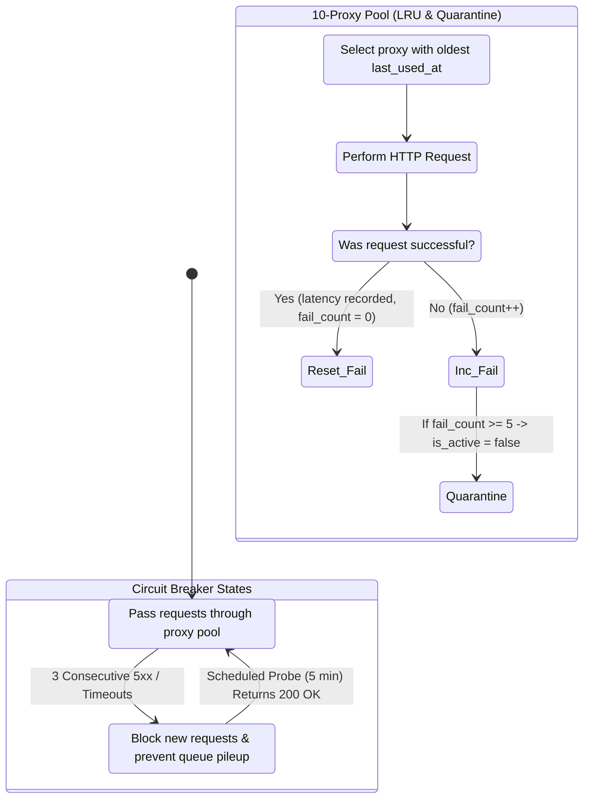

# ADR-003: Government API Resilience, Dual Circuit Breakers, and Proxy Throttling

## Status
Accepted (In Production)

## Context
Continuous integration with government procurement portals (specifically Brazil's PNCP) presents severe operational challenges in production:
1. **Asymmetric API Outages:** The PNCP architecture is divided into multiple independent services (the Search/Publishing API `/v1/contratacoes/publicacao` and the Management/Item API `/v1/orgaos/.../compras/.../itens`). These services frequently fail independently (e.g., search works while item endpoints return 500/504 timeouts, or vice versa).
2. **Aggressive WAF Blocking & IP Blacklisting:** During high-concurrency ingestion and national polling across all 27 federative units, our primary server IP was blocked by Cloudflare/WAF with 403 Forbidden responses.
3. **Resource-Constrained Proxy Infrastructure:** Budget constraints limited the operation to a modest pool of **10 reverse proxy IPs**. Naive round-robin without health checks or throttling quickly saturated and burned these proxies.

## Decision
We implemented a comprehensive **Resilience and Throttling Subsystem**:

1. **Dual Independent Circuit Breakers:**
   - `PncpConsultaCircuitBreaker`: Monitors and protects the Search/Publishing API.
   - `PncpManagementCircuitBreaker`: Monitors and protects the Item and Attachment Download APIs.
   - **Trip Logic:** After 3 consecutive HTTP 5xx errors or timeouts, the circuit trips to `OPEN`, immediately suspending external job execution and warning queue dispatchers.
   - **Automated Health Monitoring:** Async scheduler commands (`pncp:monitor-consulta` and `pncp:monitor-management`) run lightweight probe requests every 5 minutes to restore circuits to `CLOSED` without human intervention.
2. **Smart 10-Proxy Pool with LRU Rotation and Auto-Quarantine (`Proxy` Model):**
   - **Least-Recently-Used (LRU) Scope:** Requests select the active proxy with the oldest `last_used_at` timestamp (`orderBy('last_used_at', 'asc')`).
   - **Latency Telemetry & Auto-Quarantine:** Each proxy tracks `latency_ms` and consecutive failures (`fail_count`). If a proxy incurs 5 consecutive failures, it is automatically marked `is_active = false` (quarantined), preventing bad nodes from failing jobs.
3. **Adaptive Ingestion State Machine (`Active` vs. `Reposing`):**
   - **Active Searches (`status = 'processing'`):** Polled every 10 minutes with rate-limited delays (5s between jobs) and batch pagination (reusing established HTTP connections to ingest 3-5 pages of 50 items each).
   - **Reposing Searches (`status = 'done'`):** Once all historical and current tenders for a state are consumed, the search enters standby and is polled slowly every 2 hours. If a single new item is detected on the last page offset (`ExtractionTracker`), the search is **auto-promoted** back to `processing` immediately.

## Consequences

### Positive
- **Zero Scraping Downtime:** The ingestion pipeline runs 24/7 across all 27 Brazilian states without IP bans or queue saturation.
- **Fail-Fast Protection:** Prevents thousands of failed queue jobs from overloading Redis/PostgreSQL when government endpoints experience upstream outages.
- **Maximized Proxy Lifespan:** Intelligent LRU rotation and backoff delays allowed 10 proxy IPs to handle national-scale ingestion reliably.

### Negative / Trade-offs
- **Delayed Ingestion During Outages:** When PNCP endpoints are down, new tender ingestion pauses for 5-minute intervals (an acceptable trade-off to avoid IP blacklisting).
