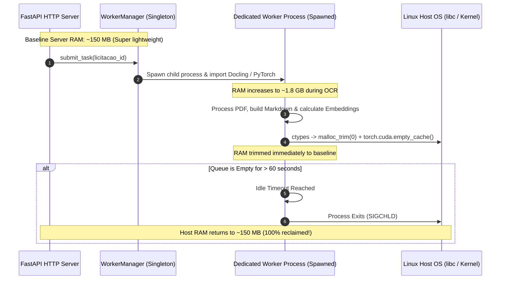

# ADR-004: Ephemeral Python Worker Lifecycle and OS Memory Reclamation

## Status
Accepted (In Production)

## Context
For advanced document comprehension, the system ingests multi-column and complex PDF edicts with embedded tables using **IBM's Docling** (for layout extraction and Portuguese OCR) and **LlamaIndex** (for structured chunking).

In production, running deep learning models (PyTorch, torchvision, ONNX runtime, EasyOCR/Tesseract) inside a persistent Python web server or standard Celery worker on a single cost-effective cloud virtual machine (AWS EC2) causes severe operational problems:
1. **Memory Fragmentation & Leaks:** PyTorch and underlying C++ libraries allocate large memory pools that are not automatically released back to the Linux host OS after document processing. Even with Python's garbage collector (`gc.collect()`), the virtual memory size (VIRT/RES) of the process grows monotonically until Linux triggers an OOM (Out Of Memory) kill.
2. **Resource Starvation:** A permanently resident OCR process consumes 1.5 GB to 3.0 GB of RAM idling, starving the core Laravel web server, PostgreSQL database, and Redis instances running on the same host.

## Decision
We implemented a **Lazy-Spawned Ephemeral Worker Process with Idle Timeout and Explicit OS Heap Reclamation** (`worker.py` + `orchestrator.py`):

1. **Lazy Process Spawning (`WorkerManager`):**
   - The FastAPI microservice does not load heavy PyTorch or Docling libraries into the main HTTP process.
   - When a document ingestion task arrives via `POST /api/v1/licitacao/{id}/processar`, the `WorkerManager` spawns a dedicated worker process via `multiprocessing.get_context("spawn")`. Heavy libraries are imported **strictly inside the child worker process**.
2. **Explicit Per-Document Memory Cleanup (`cleanup_memory`):**
   - After each PDF file is processed, the worker executes a 3-step cleanup routine:
     1. Python Garbage Collection: `gc.collect()`.
     2. PyTorch CUDA / MPS Cache Purge: `torch.cuda.empty_cache()` and `torch.cuda.ipc_collect()`.
     3. **Linux Kernel Heap Reclamation:** Invokes the GNU C Library's `malloc_trim(0)` directly via `ctypes.CDLL("libc.so.6").malloc_trim(0)` to force the release of free memory from the heap back to the operating system.
3. **Idle Timeout Termination:**
   - If the task queue remains empty for longer than `WORKER_IDLE_TIMEOUT_SECONDS` (default: 60 seconds), the child worker process exits cleanly, releasing **100% of allocated RAM and VRAM back to the host operating system**.

## Consequences

### Positive
- **Rock-Solid Long-Term Stability:** Zero OOM crashes or cumulative memory leaks over months of continuous production runs.
- **Cost-Effective Single-Host Architecture:** Enables heavy PyTorch and OCR operations to run safely alongside database and web services on a standard AWS EC2 instance without paying for oversized instances.
- **Fast Startup for Batched Jobs:** Once spawned, the worker processes consecutive tenders in milliseconds without restarting until the queue drains.

### Negative / Trade-offs
- **Cold-Start Penalty for Isolated Jobs:** The first document processed after an idle period incurs a ~2 to 3 second initialization delay while PyTorch and Docling models load into memory (negligible for background asynchronous jobs).
