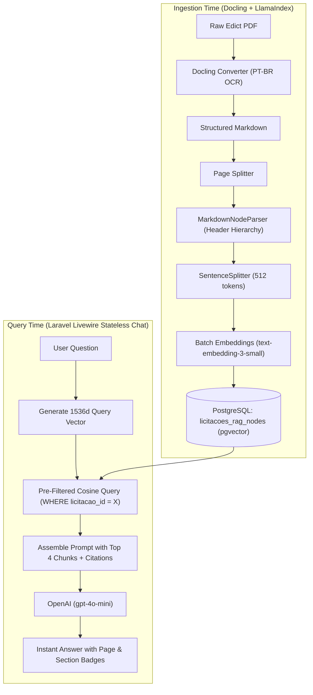

# ADR-005: Stateless Pre-Filtered RAG with Hierarchical Markdown Chunking

## Status
Accepted (In Production)

## Context
Commercial bid analysts and procurement managers need to inspect specific legal and operational nuances in public tenders (e.g., *"What is the deadline for sample delivery?"*, *"Is ISO 9001 required for Lot 2?"*, *"What are the disqualification criteria?"*).

A typical tender edict contains 50 to 100+ pages of dense legal formatting, numbered hierarchical clauses (e.g., `1.1.2`, `Section 4.3 - Technical Qualification`), and tabular requirements.

Traditional naive RAG implementations introduce two major flaws:
1. **Multi-Turn Chat History Token Explosion:** Retaining extensive conversation history across questions on long documents quickly exhausts context windows and generates unsustainable token costs for internal tooling.
2. **Fixed-Size Character Chunking Destroys Clause Hierarchy:** Naively splitting PDFs every 1,000 characters cuts tables and legal subsections in half, separating critical context (e.g., a penalty clause separated from the section title that defines its applicability).

## Decision
We implemented a **Stateless Pre-Filtered RAG Subsystem** with **Hierarchical Markdown Chunking** using **Docling**, **LlamaIndex**, and **PostgreSQL (pgvector)**:

1. **Docling Layout-Aware Conversion to Markdown:**
   - Raw PDFs are parsed with IBM Docling, converting multi-column text and tables into structured Markdown with intact heading hierarchies (`#`, `##`, `###`) and page demarcations (`## Página X:`).
2. **Hierarchical Node Chunking with Token Guardrails:**
   - **`MarkdownNodeParser` (LlamaIndex):** Segments documents based on Markdown headers, preserving complete subsections under their parent context (`header_path`).
   - **`SentenceSplitter` (Sub-chunking):** Splits over-sized sections into safe chunks (`CHUNK_SIZE = 512`, `CHUNK_OVERLAP = 50`).
   - **Token Guardrail (`count_embedding_tokens` with `tiktoken`):** Strict verification ensures no node exceeds `MAX_CHUNK_TOKENS` (500 tokens), preventing embedding API failures.
3. **Stateless Query Lifecycle with Pre-Filtered Cosine Distance:**
   - The user query is converted into a 1536-dimensional vector using OpenAI's `text-embedding-3-small`.
   - **Pre-Filtering:** The vector search strictly pre-filters chunks by `licitacao_id` in PostgreSQL:
     ```sql
     SELECT id, page_no, header_path, text_content, metadata_json,
            (embedding <=> :query_vector::vector) as distance
     FROM licitacoes_rag_nodes
     WHERE licitacao_id = :licitacao_id
     ORDER BY distance ASC
     LIMIT 4;
     ```
   - **Stateless Single-Prompt Synthesis:** The top 4 chunks are assembled with clear origin badges (File Name, Page Number, Section Title) and fed into `gpt-4o-mini`. Conversation history is not carried over between distinct questions, keeping prompt size bounded and costs minimal.



## Consequences

### Positive
- **Guaranteed Context Integrity:** Preserving Markdown headers ensures retrieved chunks always carry their parent clause context.
- **Strict FinOps Budget:** Stateless queries ensure every question costs ~$0.00015 to answer, regardless of whether it is the 1st or 20th question asked about a tender.
- **Direct Traceability:** Every response highlights the exact document name, page number, and section header for instant human verification.

### Negative / Trade-offs
- **Lack of Multi-Turn Anaphora Resolution:** A follow-up question like *"And what about item 2?"* without mentioning the previous topic requires the user to restate the context (an acceptable trade-off for an analytical search cockpit).
